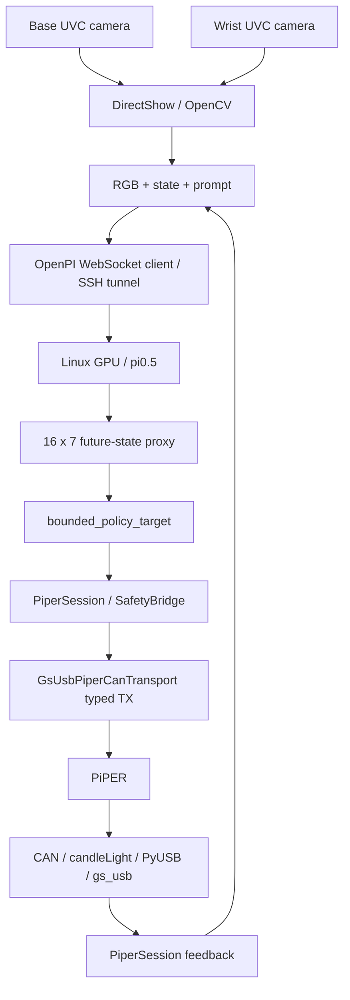

# Current runtime architecture

本文件描述当前实际调用链。当前状态见 [CURRENT_STATUS](CURRENT_STATUS.md)，
输入输出合同见 [ACTION_SEMANTICS](ACTION_SEMANTICS.md)。

## Current runtime architecture

Windows 负责相机、机器人反馈和命令；Linux GPU 服务器负责模型推理。
当前主要链路 **不使用 ROS2，也不使用 EtherCAT**。

## Data flow

观察由 RGB、七维实测状态和文本任务组成，客户端经 SSH 转发到 loopback 服务。
服务器输出未来状态代理，Windows 将选定行解释为受限绝对位置目标，再由安全桥
和 typed transport 发 CAN，读取反馈核对。服务器元数据中的 `prediction_only=true`
描述服务器职责；它不能证明整套系统不会运动。

## Current execution path

当前主要 HIL 入口是 [bounded_model_trial](../laptop/client/bounded_model_trial.py)。

`bounded_model_trial → bounded_policy_target → PiperSession → SafetyBridge →
GsUsbPiperCanTransport → PiPER`。

每次迭代采新鲜图像与反馈、请求推理、选 action 行、限幅、发送目标并等待到位。
CAN 目标包括模式/速度帧、六轴关节目标帧和夹爪目标帧。当前实验固定 5% 速度。
各步重新打开 transport 并重新做检查；这不是连续 10 Hz action scheduler。

服务器实际入口是 `server.training.serve_trained_demonstrations`，从 COMPLETE
training report 装载 checkpoint，校验 dataset/norm/provenance，并生成客户端
identity lock。其内部使用 multi-episode derived-state server/config。
端口与运行目录集中在 [RUNBOOK](RUNBOOK.md)，不在本页重复维护。

## Formal / alternative path

项目还保留另一条正式受监督路径；它不等同于当前 commissioning 实验的验收。

`PolicyPrediction → P12GateEvidence → verified preview → CommandProposal →
PositionCommandBatch → send_supervised_position`。

正式路径需要相应证据与授权，当前 bounded 路径使用 commissioning snapshot
和 BoundedTrialBatch。代码存在、实验发送成功不能自动让正式 P12/P13 PASS。
旧 direct sender 被 fail-closed guard 阻断，但其中 helper 和测试依赖仍保留。

## Missing architecture components

下面组件尚未在当前主要执行路径中实现或验证，不属于上图的已部署链路。

| 组件 | 状态 |
|---|---|
| Continuous scheduler / 完整 chunk 消费 | NOT IMPLEMENTED |
| Trajectory interpolation / smoothing | NOT IMPLEMENTED |
| Independent continuous watchdog | NOT IMPLEMENTED |
| Validated physical safe-hold | NOT VERIFIED |
| Autonomous task runtime | NOT IMPLEMENTED |

目录职责见 [PROJECT_LAYOUT](reference/PROJECT_LAYOUT.md)，实际生效的控制检查见
[SAFETY_AND_CONTROL](SAFETY_AND_CONTROL.md)。
